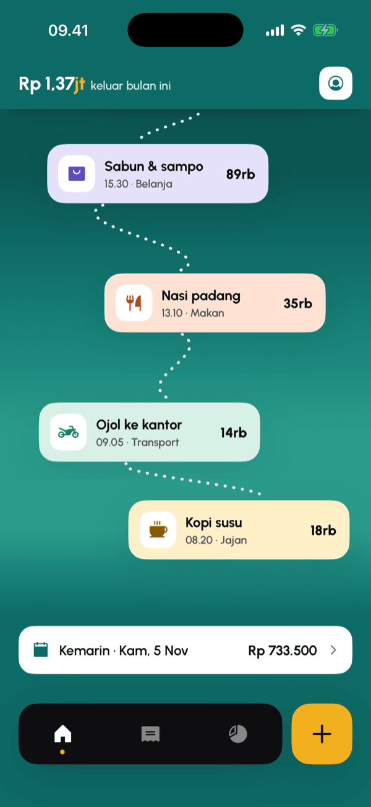
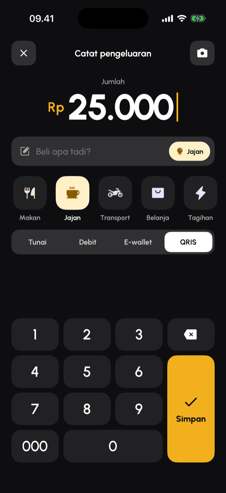
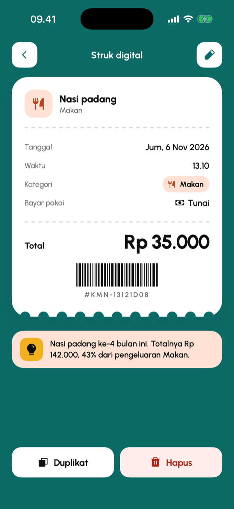
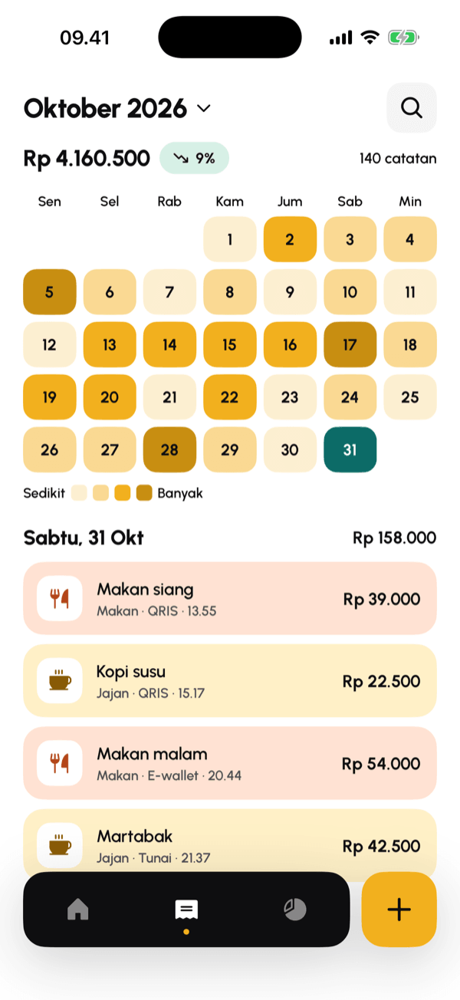
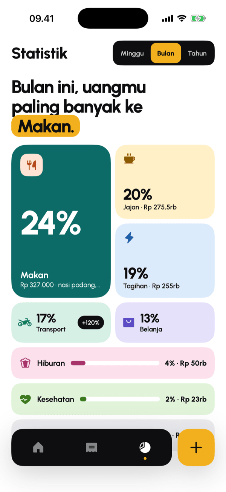
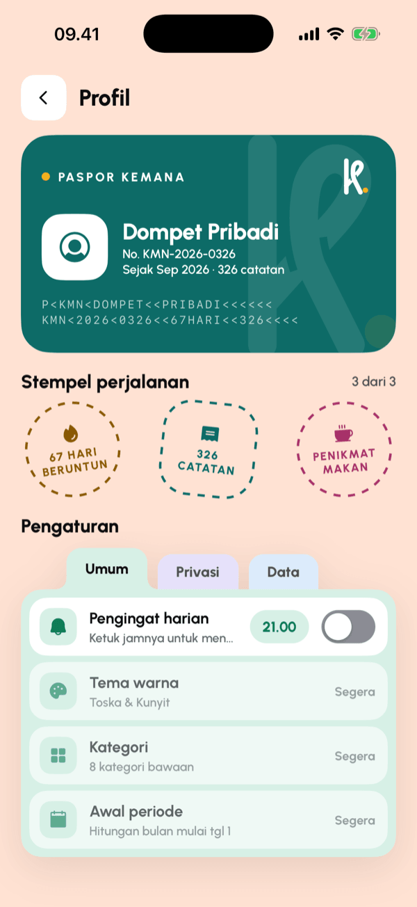
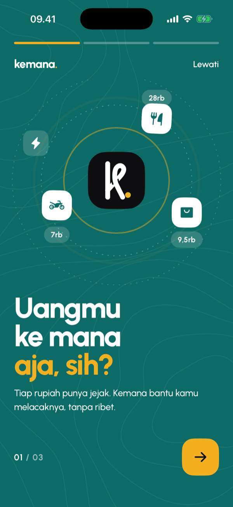
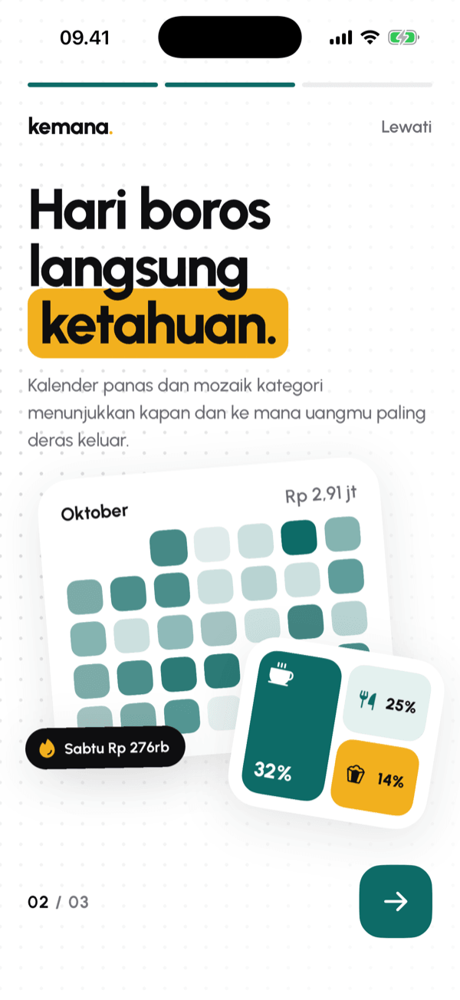
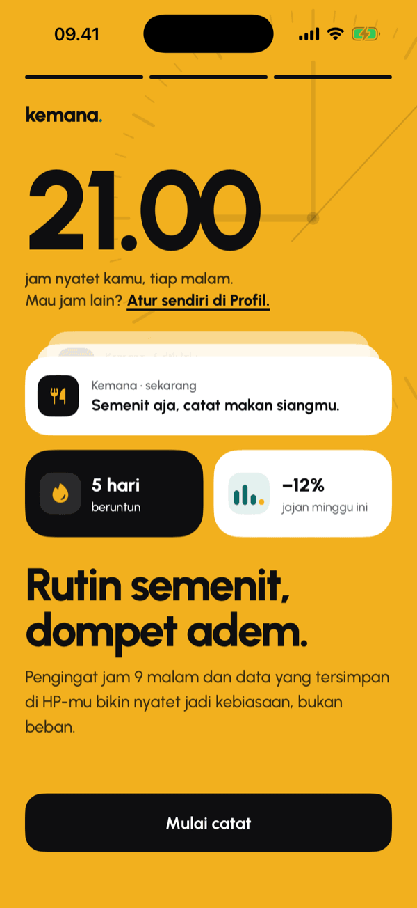

<p align="center">
  
</p>

<h1 align="center">Kemana</h1>

<p align="center">
  <b><i>"Uangmu ke mana aja, sih?"</i></b><br>
  <sub>Where did all your money go?</sub>
</p>

<p align="center">
  
  
  
  
  
  
</p>

**Kemana** is a personal expense tracker for Indonesian users, built with web technology and shipped as a native app with Capacitor. Every expense becomes a stop on today's *jejak* (trail), so you can see at a glance where your rupiah went, morning to night. All data stays on your phone in a local SQLite database: no account, no server, no tracking.

The interface is in Bahasa Indonesia.

## Features

- **Today's trail (Jejak hari ini).** Today's expenses form a winding path down the home screen. Its background shifts through teal shades from morning (*pagi*) to night (*malam*).
- **Fast entry (Catat).** A big custom keypad with a `000` key, 8 pastel categories and 4 payment methods (cash, debit, e-wallet, QRIS). Saving takes a few taps.
- **History heatmap (Riwayat).** A month calendar shaded from light to dark by how much you spent each day, with a month picker and month-over-month change.
- **Digital receipt (Detail).** Every entry opens as a receipt with a barcode, a small insight ("Nasi padang for the 4th time this month…") and a duplicate action.
- **Category mosaic (Statistik).** A weekly, monthly or yearly breakdown drawn as tiles sized by share, with the biggest category called out in the headline.
- **Passport profile (Profil).** A passport-style card with stamps for streaks, record count and favorite category.
- **Daily reminder.** A local notification at a time you choose (21.00 by default).
- **CSV export.** Share all records as a CSV file you can open in Excel.
- **Onboarding.** Three animated welcome slides.

## Screenshots

<table>
  <tr>
    <td align="center"><br><sub>Beranda: home</sub></td>
    <td align="center"><br><sub>Jejak: today's trail</sub></td>
    <td align="center"><br><sub>Catat: new expense</sub></td>
    <td align="center"><br><sub>Detail: digital receipt</sub></td>
  </tr>
  <tr>
    <td align="center"><br><sub>Riwayat: history heatmap</sub></td>
    <td align="center"><br><sub>Statistik: category mosaic</sub></td>
    <td align="center"><br><sub>Profil: passport &amp; settings</sub></td>
    <td align="center"><br><sub>Home-screen icon</sub></td>
  </tr>
  <tr>
    <td align="center"><br><sub>Welcome 1/3</sub></td>
    <td align="center"><br><sub>Welcome 2/3</sub></td>
    <td align="center"><br><sub>Welcome 3/3</sub></td>
    <td align="center"><br><sub>Splash</sub></td>
  </tr>
</table>

<sub>Screenshots from the iOS Simulator (iPhone 17 Pro) with demo data.</sub>

## Design highlights

- **Squircles everywhere.** Cards and buttons use iOS-style continuous corners (about 60% corner smoothing), drawn with CSS `clip-path: shape()` and falling back to a plain `border-radius` on older engines. See `.sq` in [`src/styles/kemana.css`](src/styles/kemana.css).
- **Toska & Kunyit palette.** Deep teal `#0D6B67` paired with turmeric yellow `#F2B01E`, plus near-black ink for the entry screen and dock.
- **A pastel per category.** Food, snacks, transport, shopping, bills, entertainment, health and other each get their own soft background and icon color, reused on the trail, the receipt and the mosaic.
- **A trail that looks random but stays put.** [`src/lib/jejak.ts`](src/lib/jejak.ts) derives each card's horizontal position from a hash of its id, so the path winds differently every day but never jumps between renders. Entries are grouped into *pagi / siang / sore / malam*, and the background gradient follows the time of day.
- **The "Pita" logo.** A lowercase *k* tied like a ribbon, with a turmeric dot. It is defined once as SVG paths in [`src/lib/logo.ts`](src/lib/logo.ts), used by the in-app component and by [`scripts/logo.mjs`](scripts/logo.mjs), which renders the app icon and splash sources.

## Tech stack & architecture

| Layer | Choice |
| --- | --- |
| UI | React 19, React Router 7, TypeScript 7, Phosphor Icons, Urbanist variable font |
| Build | Vite 8, oxlint, pnpm |
| Native shell | Capacitor 8 (iOS project included; Android project generated but not yet tested) |
| Storage | SQLite through `@capacitor-community/sqlite`; in the browser, `jeep-sqlite` (sql.js + IndexedDB) |
| Device | `@capacitor/local-notifications`, `filesystem`, `share`, `status-bar`, `splash-screen` |

```
src/
├── screens/      one file per screen: Sambutan, Beranda, Catat, Riwayat, Detail, Statistik, Profil
├── components/   shared pieces: Dock, HeaderRingkas, LogoPita
├── lib/          pure logic (trail layout, summaries, statistics, profile stamps) + unit tests
├── data/         SQLite connection, schema, record queries, categories & payment methods
└── styles/       design tokens, squircle, pastel classes
scripts/logo.mjs  renders the logo into assets/ for @capacitor/assets
```

Calculations live in `src/lib` as plain functions with no React or Capacitor imports, so they are tested with Node's built-in test runner. The screens only read from `src/data` and render.

## Getting started

Requirements: Node 22+, pnpm, and Xcode for iOS or Android Studio for Android.

```bash
pnpm install
pnpm dev            # runs in the browser, with SQLite in IndexedDB
```

**iOS**

```bash
pnpm build
pnpm exec cap sync ios
pnpm exec cap open ios   # then Run in Xcode
```

**Android** (not tested yet, see the roadmap)

```bash
pnpm build
pnpm exec cap sync android
pnpm exec cap open android
```

### Scripts

| Command | What it does |
| --- | --- |
| `pnpm dev` | Vite dev server |
| `pnpm build` | Type-check and build to `dist/` |
| `pnpm test` | Unit tests for `src/lib` (Node test runner) |
| `pnpm lint` | oxlint |
| `pnpm logo` | Re-render the "Pita" logo, then generate iOS/Android icons and splash screens |

## Roadmap

Kemana works end to end, but it is not finished. Planned next:

- [ ] Edit an existing entry (the pencil button on the receipt is a placeholder for now)
- [ ] Search in history
- [ ] Automatic backup to iCloud / Google Drive
- [ ] App lock with biometrics or PIN, and hiding amounts on the home screen
- [ ] Encrypt the local database (it currently opens as `no-encryption`)
- [ ] Custom categories, color themes and a custom month start
- [ ] Receipt photo capture
- [ ] Build and test on Android (so far it has only run on the iOS Simulator)

## License

[MIT](LICENSE) © 2026 Daivageralda
