<p align="center">
  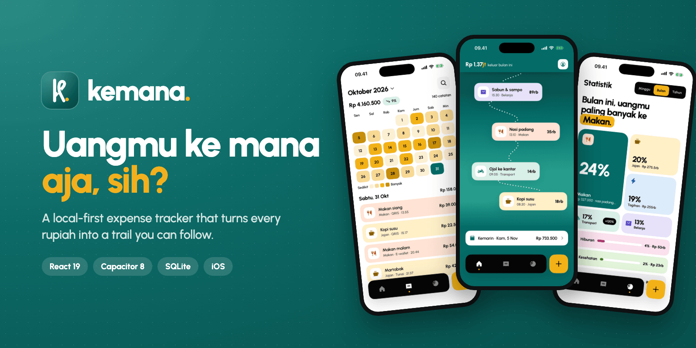
</p>

<p align="center">
  
  
  
  
  
</p>

<p align="center">
  <a href="#-features">Features</a> ·
  <a href="#-a-tour-of-the-app">Tour</a> ·
  <a href="#-design-system">Design</a> ·
  <a href="#-architecture">Architecture</a> ·
  <a href="#-getting-started">Getting started</a> ·
  <a href="#-roadmap">Roadmap</a>
</p>

<br>

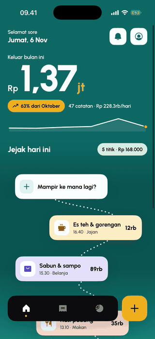

### *"Uangmu ke mana aja, sih?"*
<sub>Where did all your money go?</sub>

**Kemana** is a personal expense tracker for Indonesian users, built with web technology and shipped as a native app with Capacitor.

Instead of a spreadsheet of numbers, every expense becomes a stop on today's ***jejak***, a trail that winds down the home screen from morning to night. A heat-map calendar shows which days ran hot, and a category mosaic shows where the month went.

- 🔒 **Local-first.** Everything lives in SQLite on your phone. No account, no server, no tracking.
- ⚡ **Fast to log.** Amount, category, payment method, save. A few taps.
- 🇮🇩 **Made for Indonesia.** Rupiah formatting (`Rp 1,37jt`), QRIS and e-wallets as payment methods, an interface fully in Bahasa Indonesia.
- 🎨 **Designed, not templated.** Squircles, a teal-and-turmeric palette, one pastel per category, a hand-built logo.

<br clear="right">

## ✨ Features

| | |
| --- | --- |
| 🧭 **Today's trail** | Today's expenses form a winding path whose background shifts from morning to night. |
| ⌨️ **Quick entry** | A big custom keypad with a `000` key, 8 categories and 4 payment methods (cash, debit, e-wallet, QRIS). |
| 🔥 **History heat map** | A month calendar shaded by how much you spent each day, with a month picker and month-over-month change. |
| 🧾 **Digital receipt** | Each entry opens as a receipt with a barcode, a small insight and a duplicate action. |
| ✏️ **Edit entries** | The pencil on the receipt reopens the entry in the keypad screen to fix the amount, note, category or payment method. The original date and time are kept. |
| 🧩 **Category mosaic** | Weekly, monthly or yearly breakdown as tiles sized by share. |
| 🛂 **Passport profile** | A passport-style card with stamps for streaks, record count and favorite category. |
| 🔔 **Daily reminder** | A local notification at a time you choose (21.00 by default). |
| 📤 **CSV export** | Share every record as a CSV file you can open in Excel. |
| 💾 **Automatic backup** | When switched on, a JSON copy of every record is written to `Documents/Kemana/` each time the app opens and after changes (at most hourly), keeping the last 7 days. Restore any of them from Profil → Data; files are validated before anything is replaced. |

## 📱 A tour of the app

<table>
  <tr>
    <td width="50%" align="center">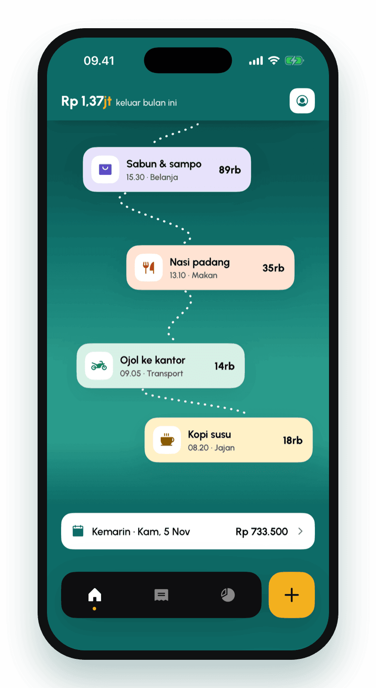</td>
    <td width="50%">
      <h3>Beranda: today's trail</h3>
      <p>The month's spending in big type, a trend line, and today's expenses connected by a dotted path. Card positions are derived from each record's id, so the trail looks hand-drawn but never jumps between renders.</p>
    </td>
  </tr>
  <tr>
    <td width="50%">
      <h3>Catat: log it in seconds</h3>
      <p>A dark, focused screen with a custom keypad. Pick one of eight pastel categories and a payment method, add an optional note, and save.</p>
    </td>
    <td width="50%" align="center">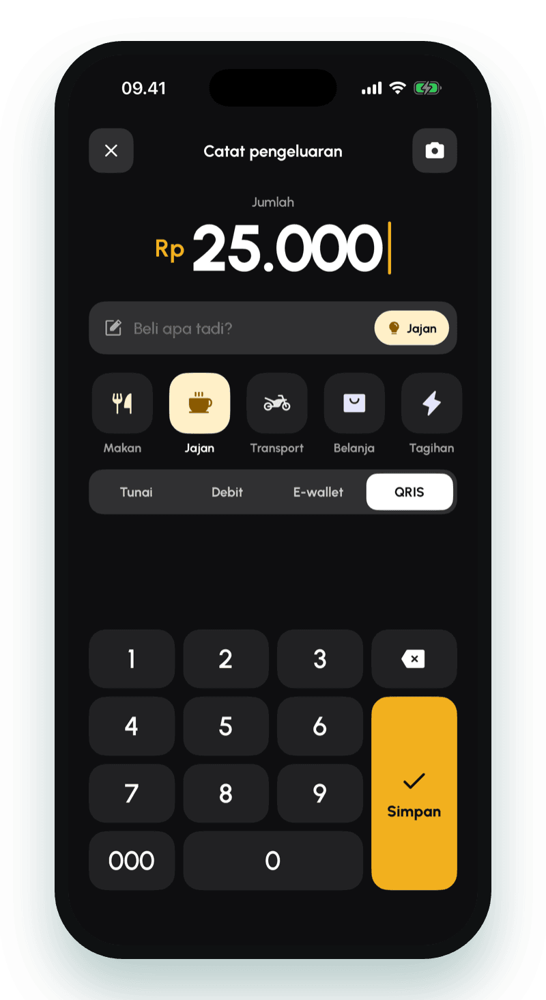</td>
  </tr>
  <tr>
    <td width="50%" align="center">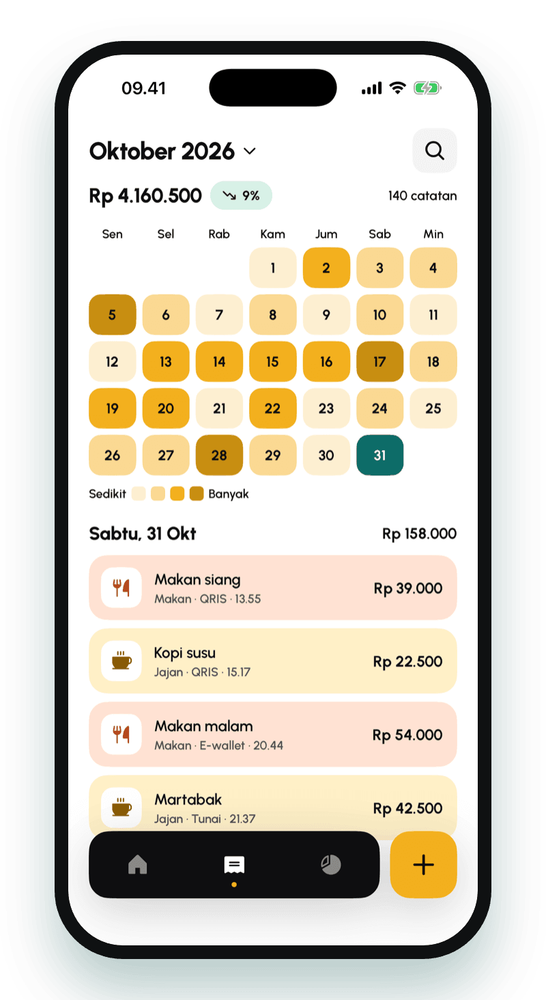</td>
    <td width="50%">
      <h3>Riwayat: the heat map</h3>
      <p>Days shade from pale yellow to deep turmeric as spending rises. Tap a day to see its entries; switch months with the native month picker.</p>
    </td>
  </tr>
  <tr>
    <td width="50%">
      <h3>Detail: a digital receipt</h3>
      <p>Every entry becomes a receipt with a scalloped edge and a barcode, plus an insight like <i>"Nasi padang for the 4th time this month, 43% of your food spending."</i></p>
    </td>
    <td width="50%" align="center">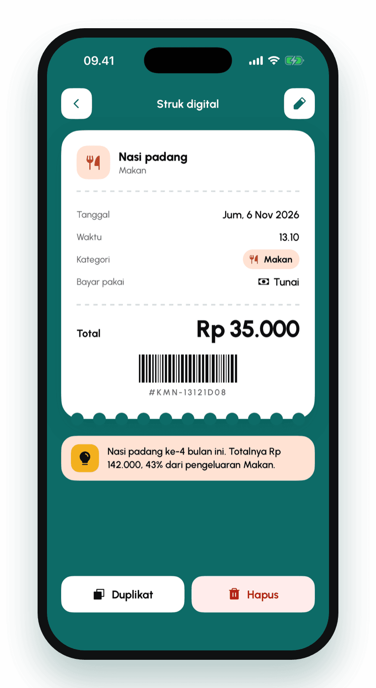</td>
  </tr>
  <tr>
    <td width="50%" align="center">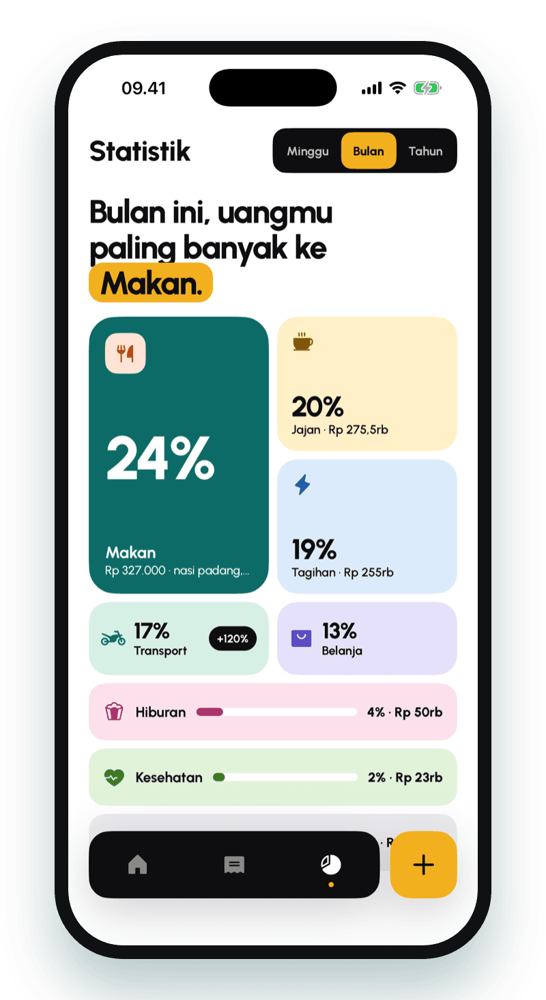</td>
    <td width="50%">
      <h3>Statistik: the mosaic</h3>
      <p>The biggest category gets the headline and the biggest tile. Switch between week, month and year; smaller categories collapse into progress bars.</p>
    </td>
  </tr>
  <tr>
    <td width="50%">
      <h3>Profil: your money passport</h3>
      <p>A passport card with a machine-readable zone, travel stamps earned from your habits, and tabbed settings (the daily reminder and data export work today; privacy options are marked "Segera").</p>
    </td>
    <td width="50%" align="center">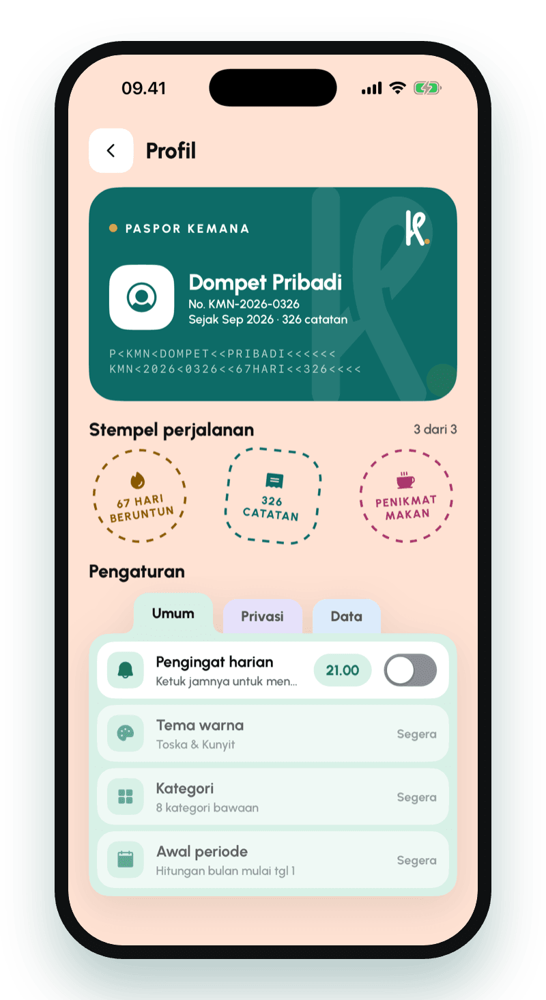</td>
  </tr>
</table>

### First launch

<p align="center">
  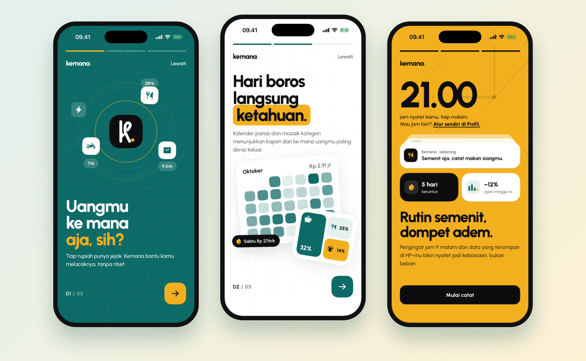
</p>

<details>
<summary><b>More screenshots</b> (splash, home, home-screen icon)</summary>
<br>
<p align="center">
  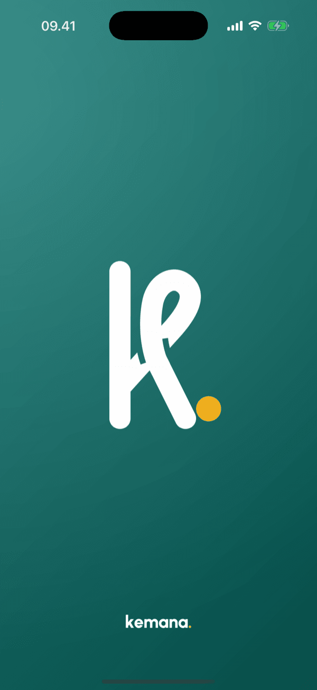&nbsp;
  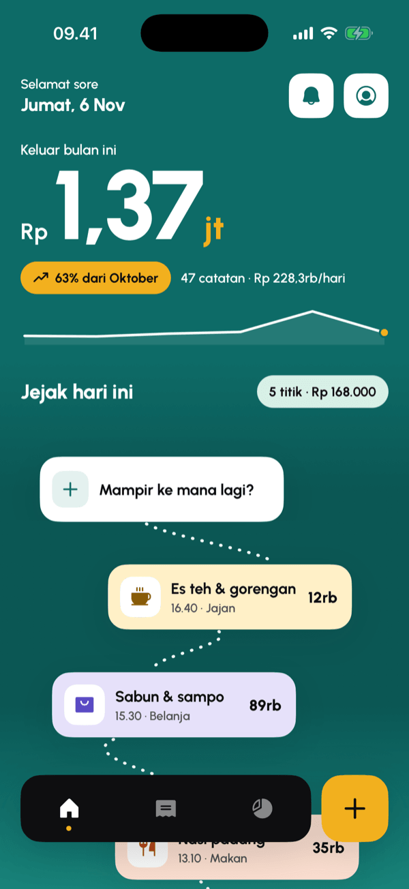&nbsp;
  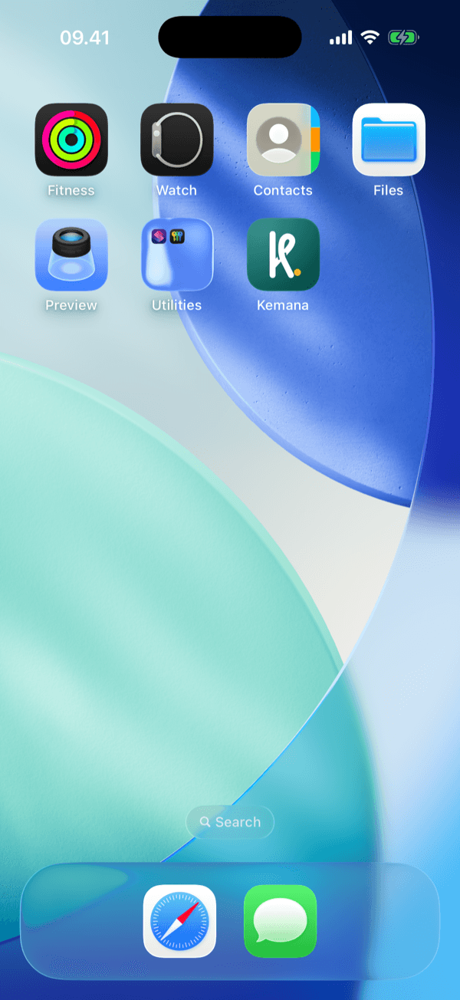
</p>
</details>

<sub>Screenshots and demo recorded on the iOS Simulator (iPhone 17 Pro) with demo data.</sub>

## 🎨 Design system

<p align="center">
  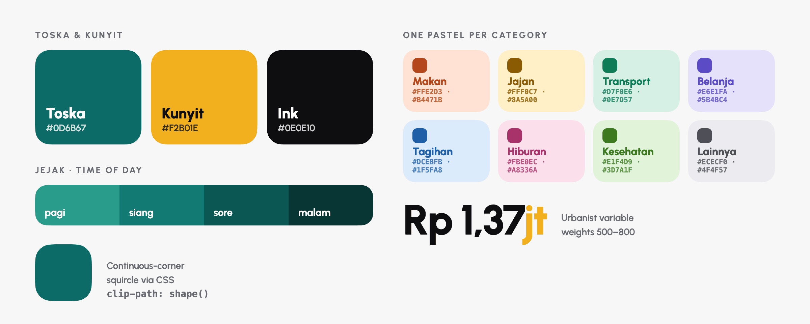
</p>

- **Squircles everywhere.** iOS-style continuous corners (about 60% smoothing) drawn with CSS `clip-path: shape()`, falling back to `border-radius` on older engines. See `.sq` in [`src/styles/kemana.css`](src/styles/kemana.css).
- **Toska & Kunyit.** Deep teal `#0D6B67` with turmeric `#F2B01E`, plus near-black ink for the entry screen and dock.
- **One pastel per category**, each pairing a soft background with an accent at ≥ 4.3:1 contrast, reused on the trail, receipt, history and mosaic.
- **Time of day.** Entries are grouped into *pagi, siang, sore, malam*, and the trail's background follows along.
- **The "Pita" logo.** A lowercase *k* tied like a ribbon, with a turmeric dot. Defined once as SVG paths in [`src/lib/logo.ts`](src/lib/logo.ts) and rendered into the app icon and splash by [`scripts/logo.mjs`](scripts/logo.mjs).

## 🏗 Architecture

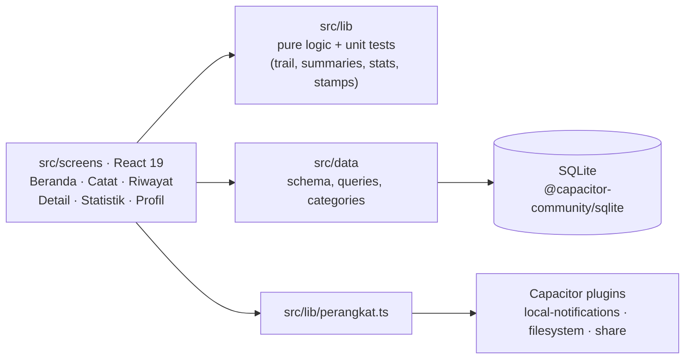

```
src/
├── screens/      one file per screen: Sambutan, Beranda, Catat, Riwayat, Detail, Statistik, Profil
├── components/   shared pieces: Dock, HeaderRingkas, LogoPita
├── lib/          pure logic (trail layout, summaries, statistics, profile stamps) + tests
├── data/         SQLite connection, schema, record queries, categories & payment methods
└── styles/       design tokens, squircle, pastel classes
scripts/logo.mjs  renders the logo into assets/ for @capacitor/assets
```

Calculations live in `src/lib` as plain functions with no React or Capacitor imports, so they run under Node's built-in test runner. In the browser (`pnpm dev`) the same SQLite schema runs on `jeep-sqlite` (sql.js + IndexedDB), so the whole app works without a device.

| Layer | Choice |
| --- | --- |
| UI | React 19, React Router 7, TypeScript 7, Phosphor Icons, Urbanist variable font |
| Build | Vite 8, oxlint, pnpm |
| Native shell | Capacitor 8 (iOS project included; Android project generated but not yet tested) |
| Storage | SQLite via `@capacitor-community/sqlite`; `jeep-sqlite` in the browser |
| Device | `@capacitor/local-notifications`, `filesystem`, `share`, `status-bar`, `splash-screen` |

## 🚀 Getting started

Requirements: Node 22+, pnpm, and Xcode for iOS (Android Studio for Android).

```bash
pnpm install
pnpm dev        # runs in the browser, SQLite stored in IndexedDB
```

<details>
<summary><b>Run on iOS</b></summary>

```bash
pnpm build
pnpm exec cap sync ios
pnpm exec cap open ios   # then press Run in Xcode
```
</details>

<details>
<summary><b>Run on Android</b> (not tested yet)</summary>

```bash
pnpm build
pnpm exec cap sync android
pnpm exec cap open android
```
</details>

| Command | What it does |
| --- | --- |
| `pnpm dev` | Vite dev server |
| `pnpm build` | Type-check and build to `dist/` |
| `pnpm test` | Unit tests for `src/lib` (Node test runner) |
| `pnpm lint` | oxlint |
| `pnpm logo` | Re-render the "Pita" logo, then generate iOS/Android icons and splash screens |

## 🗺 Roadmap

Kemana works end to end, but it is not finished. Next up:

- [ ] Search in history
- [ ] Cloud backup. Today's backup is a local file: on iOS it rides along with the device's iCloud/iTunes backup and shows up in the Files app, but there is no direct iCloud Drive / Google Drive sync, and an Android backup stays on the device. One file per day means a later backup on the same day overwrites the earlier one (an empty database is never backed up).
- [ ] Change the date and time of an existing entry
- [ ] App lock with biometrics or PIN, and hiding amounts on the home screen
- [ ] Encrypt the local database (it currently opens as `no-encryption`)
- [ ] Custom categories, color themes and a custom month start
- [ ] Receipt photo capture
- [ ] Build and test on Android (so far it has only run on the iOS Simulator)

## 📄 License

[MIT](LICENSE) © 2026 Daivageralda

<p align="center"><sub>Dibuat dengan ☕ dan banyak nasi padang.</sub></p>
